# Methodology Comparison: Paper vs Implemented vs Planned Strategy

## Comparison flow between Plan, Paper and existing code

```mermaid
flowchart LR
    subgraph PAPER[Paper Strategy]
        P1[Raw signals]
        P2[Preprocessing]
        P3[Segmentation + windowing]
        P4[Normalization]
        P5[R-DAE encoder-decoder]
        P6[Feature extraction]
        P7[Improved FCM]
        P8[Health state classification]
        P9[Health indicator + trend analysis]
        P10[RUL prediction]

        P1 --> P2 --> P3 --> P4 --> P5 --> P6 --> P7 --> P8 --> P9 --> P10
    end

    subgraph IMPLEMENTED[Implemented Strategy]
        I1[Load-cell ADC raw data]
        I2[Median / basic preprocessing]
        I3[Windowed LSTM sequence reconstruction]
        I4[Normalization / scaling]
        I5[R-DAE denoising model]
        I6[Metric evaluation against reference]
        I7[No FCM]
        I8[No health state]
        I9[No RUL]

        I1 --> I2 --> I3 --> I4 --> I5 --> I6 --> I7 --> I8 --> I9
    end

    subgraph PLANNED[Planned Upgrade Strategy]
        U1[Multi-load / multi-frequency dataset]
        U2[Robust preprocessing + calibration]
        U3[Temporal windowed R-DAE]
        U4[Feature extraction from bottleneck]
        U5[Improved FCM clustering]
        U6[Health indicator construction]
        U7[Trend fitting / degradation index]
        U8[RUL model]

        U1 --> U2 --> U3 --> U4 --> U5 --> U6 --> U7 --> U8
    end

    P5 -.same core concept.-> I5
    P5 -.upgrade to full pipeline.-> U3
    I6 -.missing FCM + health state + RUL.-> U4
    I5 -.need feature abstraction for clustering.-> U4
    U5 --> U6 --> U7 --> U8

    classDef paper fill:#E3F2FD,stroke:#1565C0,stroke-width:2px,color:#0D3B66,font-weight:600;
    classDef impl fill:#E8F5E8,stroke:#2E7D32,stroke-width:2px,color:#1B4332,font-weight:600;
    classDef plan fill:#FFF3E0,stroke:#EF6C00,stroke-width:2px,color:#7C2D12,font-weight:600;
    classDef gap fill:#F3E5F5,stroke:#6A1B9A,stroke-width:2px,color:#4C1D95,font-weight:600;

    class P1,P2,P3,P4,P5,P6,P7,P8,P9,P10 paper;
    class I1,I2,I3,I4,I5,I6,I7,I8,I9 impl;
    class U1,U2,U3,U4,U5,U6,U7,U8 plan;
    class P5,I5,U3 gap;
```

## Markdown comparison table

| Stage                  | Paper strategy                           | Implemented strategy                             | Planned strategy                                       | Difference                                      | Upgrade needed                                                                           |
| ---------------------- | ---------------------------------------- | ------------------------------------------------ | ------------------------------------------------------ | ----------------------------------------------- | ---------------------------------------------------------------------------------------- |
| Data source            | Bearing vibration signals                | Load-cell ADC recordings                         | Multi-load, multi-frequency sensor dataset             | Different domain and target objective           | Collect wider dataset with multiple loads and frequency conditions                       |
| Goal                   | Fault diagnosis + RUL                    | Noise reduction + calibration                    | Denoising + health assessment + RUL                    | Current code stops at signal quality            | Extend task from denoising to degradation tracking                                       |
| Preprocessing          | Segmentation + windowing + normalization | Scaling + windowing + median baseline comparison | Robust preprocessing + calibration pipeline            | Similar structure but weaker pipeline           | Standardize a single preprocessing function and keep train/validation split by time/load |
| Model                  | LSTM R-DAE encoder-decoder               | LSTM R-DAE denoising model                       | LSTM R-DAE + bottleneck feature extraction             | Core idea matches, but feature usage is missing | Keep R-DAE and pass bottleneck features to downstream clustering                         |
| Feature extraction     | Feature vector from bottleneck           | Mostly reconstruction metrics only               | Learn degradation features from latent space           | No clustering-ready feature matrix yet          | Build feature matrix from bottleneck output and temporal statistics                      |
| Clustering             | Improved FCM                             | Not implemented                                  | Improved FCM for health state classification           | Major missing stage                             | Add FCM module with cluster center updates and convergence logic                         |
| Health state           | Health state classification              | Not implemented                                  | Health-state labels from clustered features            | Missing                                         | Create state labels from clustered feature vectors                                       |
| Trend/health indicator | Health indicator + trend analysis        | Not implemented                                  | Trend and degradation indicator                        | Missing                                         | Fit polynomial or monotonic degradation trend to the health signal                       |
| RUL prediction         | RUL model                                | Not implemented                                  | RUL estimation from remaining life model               | Major missing stage                             | Add RUL model trained on health indicators and degradation timing                        |
| Evaluation             | Fault-health and RUL metrics             | RMSE/MSE/MAE against reference                   | Combined denoising, classification, and RUL evaluation | Different metrics and objective                 | Add classification and RUL error metrics together with denoising metrics                 |

## Where the code needs to be upgraded

### 1. Denoising core

The current model in [loadcell_noise_reduction_final.py](loadcell_noise_reduction_final.py) already follows the same R-DAE concept, so this part is good and should stay.

Upgrade focus:

- keep the encoder-decoder architecture
- extract the bottleneck representation as a feature vector
- save features for clustering and health-state analysis

### 2. Feature extraction module

The paper flow uses a feature matrix derived from the latent representation. Right now, the code evaluates only RMSE/MSE/MAE.

Upgrade focus:

- convert the bottleneck latent outputs into a feature matrix
- compute temporal statistics such as mean, variance, trend slope, and residual energy
- structure the feature matrix as samples × features

### 3. Improved FCM clustering

The current implementation has no cluster logic. This is the biggest missing step for matching the planned flow.

Upgrade focus:

- implement an improved FCM function
- initialize fuzzy centers
- compute membership matrix
- update centers until convergence
- assign health states from clustered features

### 4. Health indicator and degradation trend

Planned flow requires a health indicator built from the clustered features or reconstructed residuals.

Upgrade focus:

- build a degradation index from reconstruction error and feature drift
- fit a polynomial or piecewise trend model
- normalize the health signal for monotonic degradation behavior

### 5. RUL prediction model

The paper pipeline ends with RUL estimation, but current scripts do not include any model for remaining useful life.

Upgrade focus:

- train a regression model using health indicator history
- predict remaining life from degradation trend
- evaluate MAE or error on survival time

### 6. Dataset strategy

The current dataset is focused on one fixed load condition. The paper-style pipeline typically uses richer bearing degradation data.

Upgrade focus:

- record several known loads and multiple frequency conditions
- split data by load/frequency combination instead of only by time
- keep a truly unseen test set for final validation

## Recommended implementation order

1. Keep and refine the current R-DAE denoising model.
2. Add a feature extraction block after the bottleneck.
3. Add Improved FCM clustering and health-state assignment.
4. Build a health indicator and trend analysis module.
5. Add the RUL prediction stage.
6. Re-run evaluations using denoising + clustering + RUL metrics together.

## Final conclusion

The implemented code is aligned with the R-DAE backbone of the paper, but it is not yet aligned with the full planned workflow. The main gap is not the denoising model itself—it is the missing downstream stages: feature extraction, FCM clustering, health state classification, and RUL estimation. Those are the exact modules that should be upgraded to reach the best results based on the planned flow.
